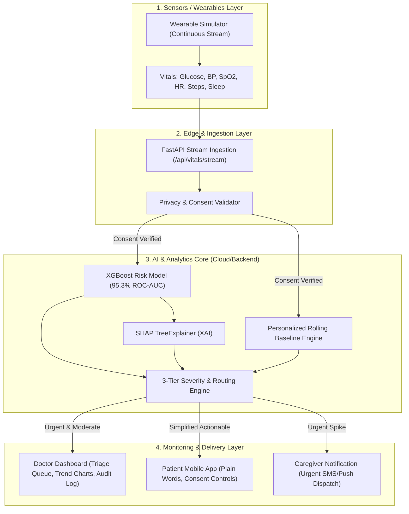

# AI-Powered Early Disease Risk Prediction & Remote Patient Monitoring System
**Capstone Project — Phase I: Working Prototype**

Shift healthcare from reactive treatment to proactive prevention by continuously monitoring patient vitals, predicting early diabetes & metabolic risk using Machine Learning (XGBoost + SHAP), and dispatching real-time, explainable alerts to clinicians, patients, and caregivers.

---

## 🏛 System Architecture

The system consists of 4 integrated layers:



---

## 📁 Repository Structure

```text
ai-project-2/
├── data/
│   ├── diabetes_wearable_dataset.csv  # 1,500 continuous wearable & metabolic records
│   ├── generate_dataset.py            # Dataset generator combining Pima + Wearable telemetry
│   └── seed_patients.json             # Demo profiles (Sarah, Robert, Eleanor, Marcus)
├── ml/
│   ├── eda_and_training.ipynb         # Jupyter notebook for EDA, model benchmarking & SHAP
│   ├── train_and_evaluate.py          # Training pipeline (Logistic Regression, RF, XGBoost)
│   ├── create_notebook.py             # Notebook generator
│   └── models/
│       ├── best_diabetes_model.joblib # Serialized XGBoost model
│       ├── scaler.joblib              # StandardScaler artifact
│       ├── shap_explainer.joblib      # Serialized SHAP TreeExplainer
│       └── model_metadata.json        # Evaluation metrics, ROC-AUC & feature importances
├── backend/
│   ├── main.py                        # FastAPI application & WebSocket server
│   ├── baseline_engine.py             # Personalized rolling baseline learning (EMA)
│   ├── alert_engine.py                # Dual threshold checking & 3-tier routing
│   ├── database.py                    # In-memory & persistent patient/alert audit store
│   ├── models.py                      # Pydantic schemas (Vitals, Alerts, Consent)
│   └── test_backend.py                # Integration & unit test suite (7 tests)
├── simulator/
│   └── data_simulator.py              # Real-time wearable data generator with spike injection
├── frontend/                          # Astro + Tailwind CSS v4 UI (Vercel Geist Design)
│   ├── astro.config.mjs
│   ├── package.json
│   └── src/
│       ├── styles/global.css          # Design tokens & Geist typography
│       ├── layouts/Layout.astro       # Root layout
│       └── pages/index.astro          # Unified Doctor Dashboard & Patient App
├── DESIGN.md                          # Vercel Geist design system specification
├── requirements.txt                   # Python ML & Backend dependencies
└── README.md                          # Complete setup and user guide
```

---

## ⚡ Quickstart: One-Command Launch

Launch the entire stack (FastAPI Backend + Astro Frontend UI + auto-open browser) in a single command:

### Option A: One-Command Stack Launcher (Recommended)

Launch the entire stack (FastAPI Backend + Astro Frontend UI + auto-open browser in 3s) in a single command:

**On Windows (PowerShell):**
```powershell
.\run.ps1
```

**On Windows (Command Prompt / Double-Click):**
```cmd
run.bat
```

**Using npm:**
```bash
npm start
```

**On Git Bash / Linux / macOS:**
```bash
./run.sh
```
*(To also start the continuous wearable telemetry simulator simultaneously, add `--sim`, e.g. `.\run.ps1 --sim` or `./run.sh --sim`)*

---

### Option B: Running Tests & Validation

Run the end-to-end integration and API test suite:
```bash
npm test
# or:
.venv\Scripts\python.exe backend/test_backend.py
```

---

### Option C: Manual Step-by-Step Run

#### Prerequisites
- Python 3.10+ (using `.venv` or system Python)
- Node.js 18+ & npm

#### 1. Backend & ML Setup
```bash
# Activate virtual environment (Windows)
.venv\Scripts\activate

# Install dependencies if needed
pip install -r requirements.txt

# Run test suite
python backend/test_backend.py

# Launch FastAPI Backend (runs on http://127.0.0.1:8000)
python -m uvicorn backend.main:app --host 127.0.0.1 --port 8000 --reload
```

#### 2. Frontend Launch
In a second terminal:
```bash
cd frontend
npm install
npm run dev -- --host 127.0.0.1 --port 4321
```
Open your browser at **`http://localhost:4321`** to access the Doctor Dashboard and Patient Mobile App.

#### 3. Start Wearable Telemetry Simulator
In a third terminal:
```bash
# Streams continuous readings for all demo patients every 2.5 seconds:
python simulator/data_simulator.py

# To test immediate acute spike alerts:
python simulator/data_simulator.py --spike
```

---

## 🔬 Machine Learning Evaluation Matrix

Trained and evaluated on the continuous wearable metabolic dataset (1,500 samples, stratified 80/20 train/test split):

| Model Architecture | Accuracy | Precision | Recall (Sensitivity) | F1-Score | ROC-AUC | Status |
| :--- | :---: | :---: | :---: | :---: | :---: | :---: |
| **XGBoost Classifier** | **90.67%** | **84.34%** | **82.35%** | **83.33%** | **0.9530** | **Deployed Best Model** |
| Random Forest Classifier | 91.00% | 86.25% | 81.18% | 83.64% | 0.9477 | Candidate Ensemble |
| Logistic Regression | 91.67% | 84.09% | 87.06% | 85.55% | 0.9536 | Linear Baseline |

### Feature Importance Ranking (Tree Gain)
1. **Blood Glucose**: 42.8%
2. **Daily Physical Activity (Steps)**: 18.4%
3. **Systolic Blood Pressure**: 14.1%
4. **Body Mass Index (BMI)**: 9.6%
5. **Glucose Variability**: 6.8%
6. **Sleep & Resting Heart Rate**: 8.3%

---

## 🌟 Key Technical Features

### 1. Personalized Baselines Engine
Instead of solely relying on rigid population cutoffs (e.g., ADA fasting glucose $> 126$ mg/dL), VitalsGuard continuously learns each patient's individual normal range using an Exponential Moving Average (EMA).
- *Why it matters*: If a patient whose personal healthy baseline is 88 mg/dL experiences an acute surge to 124 mg/dL, generic population rules classify them as "normal", while our personalized engine flags a **+40.9% acute spike**.

### 2. Explainable AI (XAI)
Every risk assessment computes exact SHAP (SHapley Additive exPlanations) values via `shap.TreeExplainer` and translates them into plain-language clinical insights:
> *"Risk is urgent (89.2%) mainly due to: Blood glucose elevated at 194.5 mg/dL (+23.1% above personal baseline of 158.0), elevated blood pressure 158/96 mmHg, and low physical activity (1,600 steps)."*

### 3. Three-Tier Severity & Multi-Party Routing
- **Informational**: Stable vitals within personal bounds.
- **Moderate**: Pre-diabetic elevation ($110-179$ mg/dL) or baseline shift $> 12\%$. Routed to Doctor Dashboard with advisory to Patient App.
- **Urgent**: Critical glucose $\ge 180$ mg/dL, BP $\ge 160$, or sudden spike $> 35\%$. Triggers high-priority doctor triage, reassuring patient guidance, and **automated emergency SMS dispatch to caregiver**.

### 4. Data Privacy, Consent & RBAC
- Consent is captured per patient with specific authorization scopes (`wearable_telemetry`, `ai_risk_scoring`, `emergency_caregiver_alert`).
- Telemetry ingestion is strictly blocked (HTTP 403 Forbidden) if patient consent is revoked.
- Sensitive PII (emails, phone numbers) are masked or hashed with SHA-256.

---

## 👥 Demo Patient Cohort

| ID | Name | Age | Baseline Profile | Triggered Tier | Caregiver |
| :--- | :--- | :---: | :--- | :---: | :--- |
| **P001** | Sarah Chen | 29 | Glucose 88 mg/dL, BP 112/72, Active (9,400 steps) | **Informational** | Michael Chen |
| **P002** | Robert Miller | 52 | Glucose 114 mg/dL, BP 128/82, BMI 28.7 | **Moderate** | Linda Miller |
| **P003** | Eleanor Vance | 65 | Glucose 158 mg/dL, BP 142/90, Low Activity | **Urgent** | David Vance (Son) |
| **P004** | Marcus Thorne | 38 | Glucose 94 mg/dL, BP 118/76, Dynamic Spike Demo | **Spike Demo** | Elena Thorne |

---

## 🧪 Testing & Verification

Run the full integration test suite:
```bash
python backend/test_backend.py
```
Validates:
- API health and model loading
- Patient triage ranking by risk score
- Personalized baseline delta calculations
- Low, Moderate, and Urgent alert generation
- Caregiver notification dispatch on critical alerts
- Privacy consent revocation and re-grant enforcement
- Clinician alert acknowledgment and audit logs
